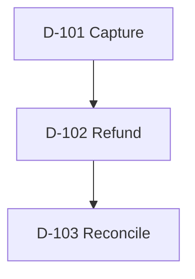
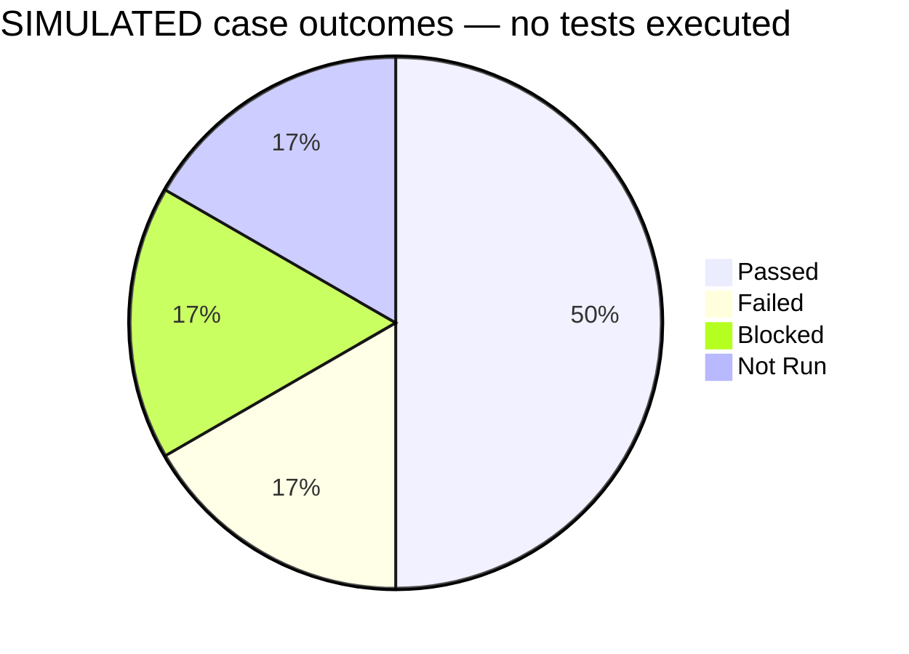
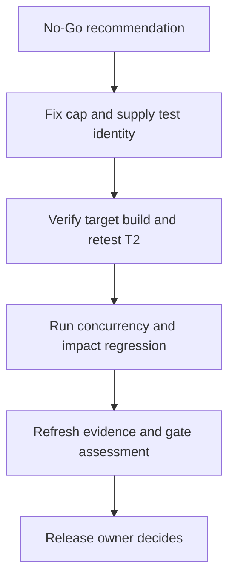

# Five-minute CTO walkthrough — From story to release decision

**OFFLINE_DEMO · FICTIONAL PRODUCT · SIMULATED OUTCOMES · NO TESTS EXECUTED**

Purpose: show how the skills connect business intent, refinement, dependencies, risk, cases, evidence and release advice. No Azure account, browser, API or application is needed to explain this example. All IDs, build names, decisions and records below are fictitious fixtures. Do not create them in a real project.

## Start the demonstration

> Use OFFLINE_DEMO. Read the shared contract, 00 and the relevant numbered skills. Use only the fixture in this file. Do not connect to Azure or execute any test. Show the confirmed dependency graph, refinement questions, financial risk, six case definitions with execution Not Run, a separate SIMULATED dashboard using the supplied fictional outcomes, and the QA recommendation. Leave the real release decision Pending. End with a 60-second explanation for the CTO.

## The five-minute visual script

| Time | Show | Say |
|---|---|---|
| 0:00–0:40 | Three stories and dependency graph | “I establish scope and prerequisites before choosing tests.” |
| 0:40–1:25 | Original gap and confirmed refinement | “I resolve the financial rules instead of inventing expected results.” |
| 1:25–2:15 | Risk-to-case table | “I combine manual judgment with repeatable API/data automation candidates.” |
| 2:15–3:20 | SIMULATED results and defect | “I verify financial effect, preserve evidence and distinguish defects from failed tests.” |
| 3:20–4:20 | SIMULATED dashboard and gates | “Percentages support the decision; the essential financial invariant controls it.” |
| 4:20–5:00 | Retest path and ownership | “The developer fixes, QA retests, the release owner decides, and the team learns.” |

## 1. Scope and dependency fixture

Source `FIXTURE-CTO-v1` defines these fictional demo stories. No live Azure extraction occurred. `DEMO-RC1` is a fictional candidate build; timestamps are deliberately not presented as actual run times.

| Demo story | Intent | Explicit fixture relation |
|---|---|---|
| D-101 | Capture a synthetic USD100.00 payment | Prerequisite for D-102: an eligible captured payment must exist |
| D-102 | Refund a captured payment | Prerequisite for D-103: refund effects must exist to reconcile |
| D-103 | Reconcile payment/refund totals | Depends on confirmed D-102 outcome |

Confirmed direction is **prerequisite → dependent**. Execution waves: capture fixture readiness, refund checks, reconciliation checks. A supplied additional `Related` link between D-101 and a help-text story D-104 does **not** establish a blocker; D-104 is outside this example’s execution scope.

Skills: 02, 03, 09. Output: scoped snapshot, confirmed edges, candidate questions and test order.

## 2. Refine before designing expected results

Original D-102 v1: **“The operator can refund a payment.”** This is incomplete.

| Question from QA | Why it matters | Fixture answer in `FIXTURE-CTO-v2` |
|---|---|---|
| Full or partial refunds? | Determines balance scenarios | Partial refunds are allowed |
| Amount and available balance? | Prevents over-refund | Positive USD amounts at two decimal places; total successful refunds cannot exceed captured amount |
| Who may refund? | Prevents unauthorized money movement | Operator may refund; Viewer may not |
| Repeated operation identity? | Prevents duplicate effect | Repeating the same refund operation identity causes no additional financial effect |
| Concurrent requests? | Protects the shared balance | Total accepted effects remain within captured amount, including concurrent requests |
| How is completion verified? | Gives an independent oracle | Successful effect updates refund totals/available balance and leaves an auditable operation; reconciliation matches capture/refund records |

These are **confirmed fictional inputs**, not rules the LLM is allowed to assume in your real product. Real API routes, HTTP codes, selectors, auth accounts and technical contracts are not supplied. Fees, FX, chargebacks, refund windows and compliance details are excluded from this small example and remain undefined for any wider strategy.

Before v2 answers, affected cases are Pending definition / Not Run. With v2 supplied, definitions can be completed and proposed for review. No human review is claimed to have happened.

Skills: 04–06, 32. Output: source-backed rules, unresolved questions and testable criteria.

## 3. Risk-driven case design

Essential risks: over-refund, duplicate effect, unauthorized refund, concurrency breach and mismatch between transaction and reconciliation data. All are P1 within this demo because they affect money/access/integrity; likelihood is Unknown.

Each case uses isolated synthetic data unless its precondition explicitly sets a prior refund. All definitions below are **Draft — awaiting review**, with **actual execution Not Run**. Interface bindings are Pending. An approved live version would need real contracts, data setup and environment readiness.

| Case | Confirmed rule / isolated setup | Actions | Observable expected outcome | Suggested method |
|---|---|---|---|---|
| T1 Partial | Captured USD100.00; Operator; no refunds | Request USD40.00 refund | Successful refund total USD40.00, available USD60.00, one auditable effect | Manual UI walkthrough + API/data automation candidate |
| T2 Excess | Captured USD100.00, confirmed prior USD40.00 refund | Request a new USD70.00 refund | Rejected, no new financial effect; total stays USD40.00 and available USD60.00 | API boundary/invariant candidate |
| T3 Replay | Captured USD100.00; refund operation K1 for USD40.00 succeeds | Repeat K1 for USD40.00 | One USD40.00 total effect; available USD60.00; no duplicate financial effect | API replay/data candidate |
| T4 Permission | Captured USD100.00; Viewer | Attempt USD10.00 refund | No authorized refund effect; unchanged financial totals | API authorization + UI manual check |
| T5 Concurrent | Fresh captured USD100.00; Operator; two distinct operation identities | Submit two USD70.00 requests concurrently | At most one accepted; total refunded never exceeds USD100.00 | Controlled API concurrency/data candidate |
| T6 Reconcile | Captured USD100.00; one confirmed USD40.00 refund fixture | Request/view reconciliation through an approved interface | Records reconcile to capture USD100.00, refunds USD40.00, available USD60.00 | API/data plus manual report review |

Cleanup: reset isolated synthetic records through an approved mechanism in any future live run. No real funds, accounts or provider traffic are used here. This six-case selection illustrates the process; it is not a complete production regression suite. Further boundary, invalid-state, provider-timeout, input-format and recovery coverage belongs in a real strategy.

Traceability fixture: cap rule → risk R-CAP → T2/T5 → future run/evidence → defect/retest → essential gate. Proposed ownership: product owner confirms rules; QA reviewer reviews cases; developer investigates implementation; QA executes/retests; release owner decides. Real people remain Unassigned.

Skills: 07–16, 31. Output: risk-based scope, cases, data plan, automation choices and review needs.

## 4. Separate fictional result injection

**SIMULATED RUN `SIM-RUN-01` · `is_simulated: true` · NOT EXECUTED**

The following records are supplied as fictional outcomes solely to demonstrate reporting. They are not outputs from Playwright, an API, Azure or a human tester. The actual cases above remain Not Run. Evidence IDs below name textual fixture records in this file, not screenshots, traces or logs.

| Case | SIMULATED outcome | Supplied fictional evidence |
|---|---|---|
| T1 | Passed | `SIM-E1`: refund total 40, available 60, one effect |
| T2 | Failed | `SIM-E2`: excess 70 accepted after prior 40; total 110, available -10 |
| T3 | Passed | `SIM-E3`: K1 replay leaves one 40 effect |
| T4 | Blocked | `SIM-E4`: Viewer test identity unavailable |
| T5 | Not Run | `SIM-E5`: concurrency execution slot unavailable |
| T6 | Passed | `SIM-E6`: isolated reconciliation fixture matches 100/40/60 |

T6’s independent passing fixture does not invalidate T2’s separate financial-integrity failure. These cases use isolated records.

### SIMULATED defect proposal

- Demo defect: `SIM-DEF-01`, not a real Azure bug.
- Expected/source: `FIXTURE-CTO-v2` cap rule; after USD40.00 refunded from USD100.00, USD70.00 must be rejected without mutation.
- Fictional actual/evidence: `SIM-E2`, refunded total USD110.00, available USD-10.00.
- Reproduction proposal: use T2’s fixture and actions; no actual endpoint binding exists.
- Proposed impact/severity: serious financial-integrity violation; adapt severity label to the real taxonomy.
- Proposed priority: P1 because a captured amount can be over-refunded.
- Triage/assignee/fix: Pending. No remote bug was created.

If a developer disputes it: show the confirmed cap rule and fictional balance calculation, propose paired reproduction in a real authorized environment, and involve the domain/product owner if intent is disputed. Do not claim a live reproduction occurred.

Skills: 17–24, 32. The demo illustrates their handoffs; it does not execute those tracks.

## 5. SIMULATED executive dashboard

**Scope: six applicable fictional cases · Build: DEMO-RC1 · SIMULATED, NOT LIVE**

| Indicator | Value / calculation | Meaning |
|---|---|---|
| Applicable planned cases | 6 | Fixed denominator for this example |
| SIMULATED status distribution | 3 Passed / 1 Failed / 1 Blocked / 1 Not Run | All six accounted for |
| SIMULATED execution coverage | (3 + 1) / 6 = **66.7%** | Blocked and Not Run excluded from executed numerator |
| SIMULATED pass rate | 3 / (3 + 1) = **75%** | Rate among completed fictional executions |
| SIMULATED distinct open defect proposals | 1 | T2’s failure; not a count of every affected risk |
| Essential unresolved evidence | Cap failed; permission blocked; concurrency unrun | These prevent a positive recommendation |
| QA recommendation for the fictional build | **No-Go** | Financial cap fails and essential checks are incomplete |
| Actual release-owner decision | **Pending / not requested in this demo** | No human approval invented |

If GitHub does not render the chart, the exact table above preserves the information.

| Essential gate — SIMULATED assessment | Evidence | State |
|---|---|---|
| No over-refund | T2 / SIM-E2 | Failed |
| Duplicate protection | T3 / SIM-E3 | Met within the fixture only |
| Permission enforcement | T4 / SIM-E4 | Missing |
| Concurrent cap enforcement | T5 / SIM-E5 | Missing |
| Independent partial/reconciliation check | T1/T6 / SIM-E1/SIM-E6 | Met within the fixture only |

The missing gates and financial failure are explicit. A larger count of passing cosmetic checks would not change this fictional No-Go.

Skills: 26–28. Output: arithmetic with denominators, source table, visible gaps and a reasoned recommendation.

## 6. Next evidence and leadership

All next actions are **proposed, not performed**. Preserve SIM-RUN-01 and any future actual runs separately. A future fix needs build verification, T2 retest, T5 concurrency execution, T4 permission execution and impact-based regression before reassessment. Do not prefill a future pass.

Coaching example: ask a junior tester why a success toast is insufficient. Review their revised assertions for available balance, duplicate effect and audit against the confirmed rules; pair on the first high-risk run. Judge the evidence and learning, not the tester’s number of cases.

Closure example: if future evidence shows an environment/test-identity bottleneck, propose an owned improvement to synthetic identity provisioning and measure blocked time in the next cycle. Do not invent an improvement percentage.

Publication example: prepare a defect/report diff for Azure; only skill 33 with explicit write scope may create it. No deployment, messages or production actions occur in this walkthrough.

Skills: 23–25 and 29–33 as applicable to a future real context. CI/postrelease behavior is explained, not demonstrated as completed work.

## 60-second CTO talk track

> “This is a fictional refund example. I first establish the stories and their prerequisites, then clarify the financial rules. I turn those rules into risk-based cases and choose which checks benefit from automation versus manual judgment. In the separate simulated run, three cases pass, one fails, one is blocked and one has not run. The completed-run pass rate is 75%, but the important finding is that the financial cap fails. I recommend No-Go, identify the missing permission and concurrency evidence, and specify the retest and regression needed. The release owner makes the decision. Each step is traceable, and the LLM must distinguish confirmed rules, proposed work and actual evidence.”

## Move from explanation to a real project

Supply the actual Azure scope, use secure interactive/session authentication, retrieve real story revisions, confirm business rules and review cases. Only then authorize a named nonproduction build, synthetic identities, real API/DOM bindings and bounded execution. Replace simulated records with actual evidence in a **new** run ledger. Keep publication and release actions independently scoped. If tools are missing, the LLM can still produce analysis and drafts while execution remains Blocked/Not Run.
