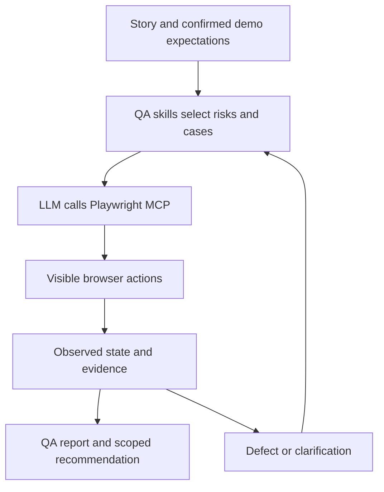

# Live CTO demonstration — QA skills + Playwright MCP

**A five-minute browser exercise in English. Execution results are Not Run until real tool output exists.**

Use this demonstration to prove the connection between QA judgment and actual browser actions. Use [99-CTO-FIVE-MINUTE-WALKTHROUGH.md](99-CTO-FIVE-MINUTE-WALKTHROUGH.md) separately to explain payment/refund risk. The public task-list exercise does not validate fintech behavior.

## Before the meeting

- Follow [PLAYWRIGHT_MCP_SETUP.md](PLAYWRIGHT_MCP_SETUP.md) in your selected local client.
- Check that the QA skills are discoverable and the browser is visible.
- Run the read-only connection check and inspect its actual receipt.
- Rehearse this small exercise before the meeting. Do not rely on an untested connection during the presentation.

### Demo scope and local acceptance contract

| Field | Defined scope |
|---|---|
| Target | `https://demo.playwright.dev/todomvc/`, a public Playwright example |
| Business story for this exercise | A user manages a task by adding it, marking it completed and removing it |
| Expectations | A newly added named task is visible; completing it changes that task's state; removing it removes that same task |
| Source of expectations | This explicitly supplied demonstration contract, not a claim about a financial product or vendor specification |
| Test identity/data | Isolated browser profile; synthetic task with a unique `QA-CTO-<run-label>` prefix |
| Allowed actions | Navigate, inspect, add/complete/remove only the exercise's own item; capture non-sensitive evidence |
| Exclusions | Load/security tests, other users' items, real money, Azure writes, production/release approval |
| Version limit | Public demo build/version Unknown unless the target exposes it; report that limitation |

If the observed demo UI cannot satisfy this contract, report the discrepancy and review it; do not automatically call it a vendor product bug. Inspect actual controls and states instead of hardcoding guessed selectors or expected error messages.

## What the CTO sees

### Five-minute screen-sharing script

| Time | On screen | Suggested words |
|---|---|---|
| 0:00–0:40 | This scope table and QA skill entry points | “My skills define the quality process. MCP provides the browser tools.” |
| 0:40–1:20 | Three proposed cases and current snapshot | “The expected outcomes are explicit. The agent uses the actual page.” |
| 1:20–3:20 | Browser: add, complete, remove | “Each result requires observed evidence; a click alone is not a pass.” |
| 3:20–4:20 | Result table, counts and evidence | “You can trace each conclusion to a case and an observed state.” |
| 4:20–5:00 | Scoped recommendation and payment-example link | “This proves the workflow connection. Release decisions require the real product's full risk and gate evidence.” |

## Three-case design

These are Draft definitions awaiting review. The run prompt asks the agent to perform a pre-execution review and record its outcome; it must not invent a human review. Actual initial result is **Not Run** for every case.

| Case | Preconditions | Steps | Observable oracle | Cleanup |
|---|---|---|---|---|---|
| LIVE-01 Add | Authorized isolated session; current page inspected; unique task name | Add the task using observed input/submit behavior | Exactly one matching newly created task is visible in its initial active state | Remove only this created task at the end or on an early stop if safe |
| LIVE-02 Complete | LIVE-01 actually passed and its item exists | Mark the same task completed using its observed control | Its completed state is observed through actual accessible/DOM state; inspect a state-specific view if needed and supported | Keep item for LIVE-03, otherwise remove it safely |
| LIVE-03 Remove | The exercise's task exists and can be identified uniquely | Remove that exact task using the actual observed interface | The matching task is absent; do not confuse a filtered-out item with deletion | Verify absence; record any residual item |

The sequence deliberately shares one item and has explicit dependencies: LIVE-01 → LIVE-02 → LIVE-03. If a prerequisite fails, mark the dependent test Blocked. A cleanup action may still remove the created item if the action is safe, but cleanup success is not a replacement for an unexecuted case.

## Copy this prompt into the connected client

> Read START_HERE.md, the shared operating contract and the procedures for skills 00, 10, 13, 20, 26, 27, 28, 32 and 34 as needed. Use Playwright MCP explicitly for this run. This request authorizes the exact browser actions and synthetic data defined in CTO_LIVE_DEMO.md, on that demo target only. It does not authorize Azure writes, production testing or release approval.
>
> First verify the actual connected tools and target readiness. Review the three demo case definitions against the supplied acceptance contract, record any corrections and the actual review outcome, and keep interface bindings Pending until inspected. If this review is sufficient under the demo policy, mark definitions Ready with an AI-review provenance; do not claim a human signed off. If a required human decision or tool is missing, stop the dependent action and explain it.
>
> Open a visible isolated browser. Inspect the current accessibility snapshot and available controls. Create a unique run label and task name. Execute LIVE-01, LIVE-02 and LIVE-03 in order through actual MCP calls, obtaining fresh references as state changes. Verify each observable expected result. Do not use guessed selectors, unrelated browser tools or fictitious tool output. Never label a case Passed because an action merely returned without an error.
>
> Save non-sensitive screenshot/snapshot evidence if the connected tools support it and record actual file references. If screenshots are unavailable, state that limitation and use sufficient textual state evidence; do not invent files. Keep actual run/attempt records and cleanup outcomes. Report target version Unknown if it cannot be identified.
>
> Return a concise English report with the case results, actual observations/evidence, counts/denominators, blockers and risks. Include a Mermaid outcome chart only if at least one real result exists, with its exact source table. If no tests complete, pass rate is No data. If all three pass, conclude “This scoped browser workflow passed”; do not conclude a fintech product or production release is ready. Keep the human release-owner decision Pending and provide a 60-second explanation for the CTO.

If your client recognizes the installed QA entry point, you can start with `/qa-orchestrate-testing-lifecycle` and then paste the same scoped request. Invocation syntax does not substitute for reading the actual demo scope and discovered tools.

## Report skeleton — fill only after execution

**Execution path:** Playwright MCP / Unverified. **Actual target:** [observed URL]. **Build:** [observed or Unknown]. **Run:** [real run label]. **Mode:** AUTHORIZED_TEST within the exact demo scope.

| Case | Actual result | Observation | Evidence reference | Blocker/cleanup |
|---|---|---|---|---|
| LIVE-01 | Not Run | None recorded | None | Pending execution |
| LIVE-02 | Not Run | None recorded | None | Pending LIVE-01 |
| LIVE-03 | Not Run | None recorded | None | Pending prerequisite |

Before execution: Passed 0; Failed 0; Blocked 0; Not Run 3. Execution coverage 0/3 = 0%; pass rate **No data**. No result chart is prefilled with invented passes.

After execution, update this table with observed outcomes; calculate execution coverage `(Passed + Failed) / 3` and pass rate `Passed / (Passed + Failed)` for applicable selected cases. Preserve attempt history separately. File existence alone does not prove an assertion passed.

## If something fails live

Show the exact failure stage and evidence. Explain whether it is MCP connectivity, browser/runtime, target readiness, test definition or observed behavior. Block dependent cases, propose a fix or refinement and preserve the original record. A truthful blocked demonstration is more useful than fabricated success.

If the live connection is unavailable, switch explicitly to the file 99 **simulated payment walkthrough** and announce the change. Never mix its fictional outcomes into this live ledger.

## Connect it to your fintech experience

> “The same traceability applies to a payment or remittance: I start from confirmed business rules, identify the money and access risks, design the right manual/API/UI/data checks, capture actual evidence and evaluate essential release gates. This task-list demo proves the tool connection only. The refund example shows the financial judgment, including when I recommend No-Go.”

For a real fintech UI, replace the target and contract only after the real environment, roles, monetary rules, test data and safe transaction scope are confirmed. Browser UI evidence may need independent API/ledger/reconciliation checks. Playwright MCP does not grant Azure DevOps access; use the separate secure-access and writeback skills.
