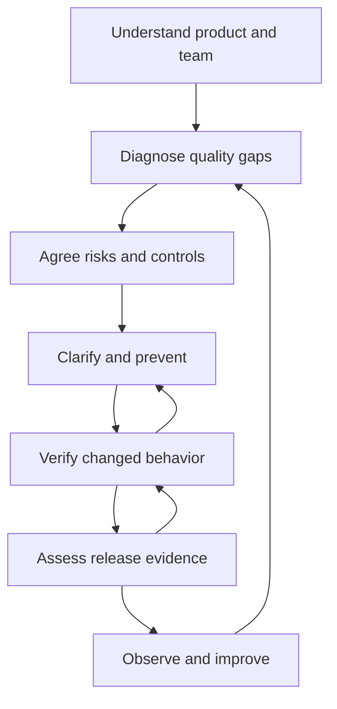

# Adaptive QA Strategy

**Author: Edward Carvajal Martinez · Senior QA Engineer / QA Lead**

## Purpose and operating principles

Establish how to understand a product and its delivery system, prevent avoidable defects, verify important behavior and make quality risks visible to decision makers. Apply this strategy to an existing product, a new implementation, a migration or a multi-product organization. Tailor its execution to the actual business domain, architecture, delivery approach and team capacity.

This is the reusable operating strategy. A project-specific strategy becomes agreed only when its scope, priorities, controls and responsibilities have been reviewed with the actual owners. Empty templates and proposed controls are not evidence of an implemented QA process.

Start by listening and observing. Do not impose tools, replace an existing workflow or infer the cause of production defects before reviewing evidence. Preserve useful practices. Investigate the system of work rather than attributing escaped defects to the experience of one tester. During discovery, escalate an observed urgent risk immediately; learning the context is not a reason to ignore it.

Quality assurance includes early clarification, testability, collaboration, prevention and process improvement. Quality control evaluates actual product behavior. Both are necessary. Testing verifies behavior and controls; development, design and operational changes implement the protections. Report the team's contribution accurately, with QA's analysis and evidence traceable.

## Strategy contents

1. [Understand the organization, product and delivery system](#1-understand-the-organization-product-and-delivery-system)
2. [Diagnose quality and delivery problems](#2-diagnose-quality-and-delivery-problems)
3. [Agree a contextual quality strategy](#3-agree-a-contextual-quality-strategy)
4. [Prevent defects before and during implementation](#4-prevent-defects-before-and-during-implementation)
5. [Design and verify risk-based coverage](#5-design-and-verify-risk-based-coverage)
6. [Choose sustainable automation](#6-choose-sustainable-automation)
7. [Manage defects, changes and release evidence](#7-manage-defects-changes-and-release-evidence)
8. [Lead people and develop capability](#8-lead-people-and-develop-capability)
9. [Use AI with accountable review](#9-use-ai-with-accountable-review)
10. [Measure outcomes and improve](#10-measure-outcomes-and-improve)
11. [Adapt the approach to different delivery contexts](#11-adapt-the-approach-to-different-delivery-contexts)

Leadership, communication, evidence review and risk management apply throughout. These activities overlap within normal delivery; the diagram does not introduce a mandatory sequential approval process.

## 1. Understand the organization, product and delivery system

### Establish the engagement

Clarify why QA support is needed, who experiences the problem, what decisions the sponsor needs and what authority the QA lead actually has. Record products, users, business objectives, release scope, deadlines, known constraints, information access and responsibilities. Ask what is working well and must be preserved.

Distinguish business goals from proposed solutions. “Improve release confidence” is an objective; “automate the UI” is one possible intervention that requires justification. Agree an initial discovery scope and a short review point. Do not promise a defect-reduction percentage without a baseline and observation period.

### Learn the product through actual workflows

Ask a product representative and a current tester to demonstrate a representative user journey. Follow its inputs, decisions, outputs, states, data and downstream dependencies. Identify who owns the expected behavior. Repeat for the most consequential workflows rather than cataloguing every screen before starting useful work.

Record:

| Area | Information to establish | Evidence / output |
|---|---|---|
| Product purpose | Users, needs, critical outcomes and unacceptable failures | Product context and stakeholder-confirmed priorities |
| Functional model | Actors, operations, business rules, states and exceptions | Process/state map linked to sources |
| Technical context | Components, interfaces, data stores, third parties and deployment boundaries | Architecture/dependency view with unknowns |
| Operating context | Supported platforms, volumes, availability needs and recovery expectations | Agreed quality requirements or open questions |
| Delivery system | How work enters, changes, is built, tested, approved and released | Actual workflow and responsibilities |
| QA capability | Existing coverage, skills, tools, data, environments and maintenance | Capability assessment without individual ranking |
| Feedback | Support reports, incidents, monitoring and user feedback | Evidence sources and access limitations |

Sources may be user stories, specifications, contracts, designs, interviews, code, logs or existing tests. Separate confirmed expectations, observed behavior, proposals and unanswered questions. The application's current behavior does not automatically define correct behavior.

### Understand the team and how work moves

Meet Product, Engineering, QA, design, operations/support and specialists as relevant. Identify decisions and handoffs, not just job titles. Shadow a tester on current work. Trace one change from definition to production and one production defect back through delivery. Compare documented practice with observed practice.

Inspect work arrival, work in progress, elapsed delivery time, waiting for review/build/data, blocked time and time available for validation. For Scrum, inspect how refinement, planning, daily coordination and retrospectives actually support quality. Velocity is a local planning measure; do not compare teams by story points or treat velocity as the explanation for defects. For other delivery models, use their existing planning and review rhythm.

**Discovery output:** context brief, stakeholder/decision map, critical-process map, observed delivery map, known sources, initial questions and urgent risks. Review for factual accuracy with the people involved.

## 2. Diagnose quality and delivery problems

Select a bounded sample of recent production defects and delivery items. State the time window, selection criteria, sample size, severity mix and missing records. Include representative successful work where possible, so diagnosis does not assume every current practice fails. A small sample reveals hypotheses and patterns; it does not establish organization-wide defect rates.

For each escape, reconstruct expected versus actual behavior, business consequence, relevant version/configuration, when the weakness was introduced, when it could have been detected, what validation occurred and what release decision was made. Distinguish **cause of the defect** from **cause of its escape**. Record the evidence and confidence behind each explanation.

Consider ambiguity, missed states, impact-analysis gaps, integration behavior, data mismatch, environment differences, late changes, incomplete assertions, unrealistic schedules, inaccessible dependencies and conscious risk acceptance. Do not label “human error” or “QA missed it” as a sufficient causal explanation.

| Diagnostic question | Evidence to inspect | Possible decision, subject to confirmation |
|---|---|---|
| Was expected behavior explicit and consistent? | Requirement revisions, refinement decisions, contracts | Add a focused pre-implementation review |
| Did coverage address the failure mechanism? | Risk links, cases, assertions and execution evidence | Extend coverage at the appropriate level |
| Was the tested build representative? | Build/configuration IDs, dependency versions, data | Improve readiness and change invalidation |
| Was validation time lost to queues? | Start/finish and blocked timestamps | Make waiting visible and reduce delivery batch size |
| Was a known gap consciously released? | Assessment, decision owner, recorded acceptance | Clarify decision authority and residual risk |
| Is a previous failure recurring? | Defect family, corrective action, regression history | Verify corrective action and regression effectiveness |

Maintain separate confirmed findings and hypotheses. Review conclusions with the contributors. Agree one focused improvement based on impact, evidence, feasibility and an observable success criterion. Record alternatives and why they were deferred.

**Diagnostic output:** escape analysis, baseline limitations, prioritized gaps and a pilot charter. Discovery is complete enough for a pilot when a critical workflow, a credible gap, an accountable owner and a verification method are known. Continue learning while improving that workflow.

## 3. Agree a contextual quality strategy

Create a short project-specific strategy using [PROJECT_TEMPLATES.md](PROJECT_TEMPLATES.md). Specify objectives, included/excluded workflows, quality expectations, risks, levels of verification, responsibilities, data/environments, cadence, evidence, release conditions and escalation paths. Obtain the relevant owners' review; retain disagreements and unresolved decisions.

Model each risk as **a failure scenario in a specific process, its consequence and its contributing conditions**. Give it a stable ID, source, priority rationale, owner, required controls and residual concern. Use the organization's existing risk taxonomy where available. If priority is provisional, label it. Do not fabricate probabilities or convert an ordinal score into a claim of measured risk reduction.

For each important risk, specify the control that should protect the process and how that control will be verified. Controls may be confirmed rule/design changes, application validation, permissions, integrity constraints, monitoring, recovery procedures or a combination. A test case is a means of verification; merely writing it does not implement the protection.

Define the minimum evidence for a meaningful assurance statement. A risk is **Verified mitigated** only when all required controls are implemented and verified with evidence applicable to the current scope/build. Failed, absent, stale, deferred and accepted controls remain visible. Many passing cases cannot offset an essential failed control.

Agree proportionate entry/exit conditions. These are contextual working agreements, not universal thresholds or additional bureaucratic gates. Keep business acceptance, QA recommendation and the authorized release decision separate.

**Strategy output:** reviewed project strategy, risk/control baseline, coverage approach, ownership and decision map, delivery plan and explicit limitations.

## 4. Prevent defects before and during implementation

Participate in requirements discussions at the point decisions can still change. Review business intent, acceptance criteria, rules, states, exceptions, dependencies, interfaces, permissions, data and applicable non-functional expectations. Ask concrete questions whose answers change design or coverage. Do not add unrelated requirements from a generic checklist.

Use short Product/Engineering/QA conversations for important uncertainties. Confirm examples of valid, invalid and boundary behavior. Resolve contradictory rules and identify dependencies before implementation of the affected behavior where possible. Record the decision, owner, source revision and chronology. If a decision cannot be resolved, show the affected scope as Pending definition and continue independent work.

During implementation, review changes and testability with developers. Agree which controls are best verified by component tests, service/contract tests, UI tests or manual exploration. Arrange early delivery of independently verifiable slices and data. Revisit analysis when requirements, architecture or external contracts change.

Propose practical readiness criteria: intent understood, essential decisions resolved, dependencies identified and a feasible verification approach. Reuse existing agreements. In Scrum, a local readiness checklist is optional; do not present it as a mandatory Scrum artifact. Adapt the Definition of Done with the team so it reflects actual required quality work and evidence.

**Prevention output:** refined expectations, decision/question log, source-linked preventive findings, testability actions and early coverage. Count a preventive finding as resolved only with a confirmed issue, a real decision/change and evidence of timing. An unanswered AI recommendation is not a prevented defect.

## 5. Design and verify risk-based coverage

Select depth from business impact, criticality, dependencies, change extent, past failures and uncertainty. Prioritize important negative paths and process integrity alongside successful journeys. For each applicable requirement maintain the chain:

**Source/revision → requirement/risk → control → case or other verification → run/build → evidence → defect/correction → retest/regression → release assessment.**

### Functional coverage

Use the following as an applicability review. Mark areas Applicable, Not applicable with a reason, or Pending clarification; their presence here does not create a requirement.

| Coverage area | Evaluate against confirmed behavior |
|---|---|
| Core processes and states | End-to-end outcomes, decision branches, permitted/forbidden transitions, cancellation and recovery |
| CRUD and relationships | Creation, read/update/delete semantics, persistence, uniqueness and referential effects |
| Input validation | Required/optional fields, missing/empty/space values, valid/invalid partitions and defined limits |
| Roles and data scope | Allowed/denied actions, direct access, UI/API consistency and organization isolation where applicable |
| Search, filters and grids | Defined search semantics, combinations, clearing, sorting, pagination, empty results and export consistency |
| Reports and calculations | Confirmed formulas, source consistency, filters, totals and output formats |
| API and integration | Contracts, authorization, errors, payloads, side effects, asynchronous states and dependency failures |
| Data and migration | Completeness, mapping, transformation, duplicates, relationships and recovery against agreed rules |
| Concurrency and repetition | Conflicting updates, retries, duplicate processing and ordering when relevant to the architecture |
| UI and supported clients | Interaction, navigation, responsive behavior and agreed browser/device compatibility |

Apply equivalence partitioning, boundaries, decision tables, state transitions and exploratory charters where they fit the risk. Each case has a source-backed expected result, preconditions, data, reproducible steps, priority and observable assertions. Keep definition states separate from execution states.

### Non-functional coverage

Start with required quality attributes, not a tool catalogue. For performance, establish representative workload, data size, concurrency, latency/error targets and environment limitations. For resilience, establish dependency-failure behavior, recovery requirements and safe experiments. For security/privacy, confirm roles, data classifications and authorized assessment scope; involve specialists where necessary. For accessibility, identify the agreed standard and user needs before assessing conformance. For compatibility, define the supported client matrix. For backup/restore and observability, agree recoverability and operational verification expectations where applicable.

Do not invent response-time targets, accessibility levels, regulatory obligations or service objectives. Missing targets remain Pending definition; absent evaluation is Not assessed. A functional pass is not proof of performance, security or resilience.

### Prepare and execute

Confirm the actual build, configuration, dependencies, accounts, test data, oracle, evidence location and cleanup before relying on results. Use safe representative data with known setup and lifecycle. Record environmental differences that limit conclusions. Protect confidential data and use isolated environments within authorized scope.

Run an appropriate smoke check, then the highest-risk applicable checks, focused integration/data validation, exploratory work and selected regression. Execute non-functional tracks when their prerequisites and scope are established. Record actual observations, timestamps, evidence and blockers; retain failed attempts as well as subsequent retests. Classify a behavior as Failed only when it contradicts a confirmed expectation.

Coordinate user acceptance with the actual business owners and representative workflows. QA can support data and evidence; it does not manufacture business acceptance.

**Verification output:** coverage matrix, reviewed cases/charters, readiness record, actual run ledger, evidence, defects and unresolved assurance gaps.

## 6. Choose sustainable automation

Select automation after understanding the failure mechanism, repeat frequency and maintenance conditions. Prefer stable checks with clear oracles, repeatable data and useful feedback. Choose the lowest effective level that verifies the required behavior; retain end-to-end checks for important cross-component journeys and exploration for learning.

| Candidate | Typical decision basis |
|---|---|
| Repeated critical regression | Automate if stable and repeatable; link to risk and own maintenance |
| Contract/integration assertions | Automate when contracts, dependencies and test data can be controlled |
| Calculation or transformation rules | Consider component/API/data checks with independent expected values |
| Repetitive supported-client behavior | Automate representative UI coverage when selectors and environment are maintainable |
| New/ambiguous interaction | Explore and clarify first; review automation after behavior stabilizes |
| One-time or difficult-to-oracle scenario | Assess manual/specialist validation and future recurrence before investing |

Document candidate, reason, level, prerequisites, owner and defer/exclude rationale. Do not set an arbitrary percentage to automate. Tool choice follows the system and available expertise; Playwright, API clients, SQL tools and CI products are replaceable implementations.

For implemented automation define assertions, isolation, fixtures, cleanup, failure evidence and pipeline placement. Distinguish a product failure, test defect, environment issue and flaky result using evidence. Quarantine only with an owner, visible risk and a restoration action; never silently remove protection. Reassess suites when changes invalidate their purpose.

**Automation output:** justified backlog and, when implementation is requested, maintained checks linked to risks with actual execution evidence. Generated code alone is not working automation.

## 7. Manage defects, changes and release evidence

A defect record explains expected/actual behavior, reproducible conditions, build/configuration, consequence, evidence and related risks. Triage with relevant contributors. Keep severity, remediation priority and release impact distinct. Resolve disagreements through requirements and observable effects; escalate an unresolved expectation to its owner.

After a correction, verify the original failure, adjacent negative paths and impacted dependencies on the relevant build. Update regression selection and retain the original failed run. A developer's “Fixed” status is not QA verification.

Before release assess current evidence against the agreed gates, unresolved defects, essential controls, business acceptance, operational readiness and release/rollback prerequisites. Use:

| Recommendation | Meaning |
|---|---|
| Go | Agreed essential evidence supports the defined scope and applicable criteria are met |
| Conditional Go | Only permitted by the local policy; conditions, owner, deadline and residual risk are explicit; no essential failed/missing control is hidden |
| No-Go | Known essential failure or unacceptable risk contradicts agreed criteria |
| Pending assessment | Essential information or verification is insufficient for a supported recommendation |

The authorized release owner records the actual decision, including any exception to QA's recommendation. An accepted risk remains visible as residual risk and does not count as Verified mitigated. Never approve from an aggregate pass percentage.

For authorized releases, verify the scoped deployment, configuration and essential safe workflows; review monitoring and support feedback over an agreed observation window. Coordinate incident evidence and recovery with operations and the incident owner. Deployment, rollback and data repair require their actual authorized operational scope.

**Release output:** recommendation, gate evidence, residual risks, decision record, verification/observation plan and incident feedback.

## 8. Lead people and develop capability

Agree responsibilities for requirements, implementation, testing, domain decisions, environments and release. Avoid making QA the sole owner of quality or requiring the senior to perform every test. Establish practical collaboration and backups for critical knowledge.

Use current work for mentorship. Let the tester explain the workflow, propose risks and design coverage. Review reasoning together, execute a representative difficult scenario in pairs, then let the tester execute and present evidence independently. Give specific feedback and reduce supervision as competence becomes observable. Involve developers where component or integration controls are appropriate.

Assess capability using observable work: identifying relevant failure scenarios, explaining expected results, choosing techniques, reproducing defects, assessing evidence and communicating uncertainty. Do not rank people by case counts, defects found or AI usage.

Communicate at the team's existing cadence. In daily coordination, make blocks and decisions visible. In refinement, resolve risk-bearing uncertainties. In triage/release reviews, present evidence and tradeoffs. In retrospectives, evaluate a small number of corrective actions with owners and follow-up dates. Adapt cadence to the delivery model.

**Leadership output:** responsibility agreement, focused mentoring plan, reviewed work samples, escalation decisions and improvement ownership.

## 9. Use AI with accountable review

Use the project's skills to accelerate source analysis, questions, dependency mapping, risk drafting, coverage review, data design, code proposals and reporting. The senior QA remains accountable for judgment; domain owners confirm business expectations; actual tools supply execution evidence.

Provide the relevant sources, scope and artifact references. Load the next needed skills instead of sending the full library for every task. Require explicit distinctions among confirmed expectation, observation, proposal and unknown. Verify high-impact outputs against source revisions, actual environment observations and independent oracles.

Do not infer a tool connection from a configuration file, claim a browser action from generated text or fabricate a result to fill a dashboard. Unavailable tooling leaves the dependent work Blocked/Not Run. Protect credentials and confidential material; use organization-approved access and AI handling policies. External publication requires its actual authorization and sanitized evidence.

Evaluate AI assistance by correction effort, source fidelity and usefulness of reviewed outputs. Do not claim measured productivity or fewer incidents without a comparable baseline and sufficient observation. Keep model/tool context and relevant source revisions in the handoff when needed for reproducibility.

**AI output:** reviewed, source-linked artifacts and actual tool receipts where execution occurred; an explicit checkpoint preserves progress and missing information.

## 10. Measure outcomes and improve

Use [PROCESS_RISK_KPIS.md](PROCESS_RISK_KPIS.md) for exact definitions. These are operational definitions for this strategy, to be agreed locally, not universal benchmarks. Always report scope, build, period, baseline changes, counts/denominators and missing information.

The executive page leads with verified risk mitigation, unresolved critical risks, critical process assurance, shift-left readiness, preventive findings resolved and non-functional assurance. Keep test counts, pass rates and automation activity in supporting detail. Exclude financial indicators: this strategy requires no cost, savings, ROI or monetary exposure estimates.

Track production feedback and delivery constraints only when relevant records exist. Segment by product, criticality and comparable periods. Rising discovered risks may reflect improved discovery rather than worsening quality. A smaller unresolved count is not improvement if important risks were simply removed from the denominator. Retain baseline revisions and exclusion reasons.

For each proposed improvement define the gap, intervention, owner, observation window, success evidence and possible confounders. Pilot it in a small real scope, review whether the protection works and then decide to retain, modify or stop it. Check recurrence over a meaningful period before claiming sustained improvement.

**Improvement output:** one-page executive report, evidence-linked risks/actions and a reviewed improvement backlog. The report states what can be concluded and what cannot yet be measured.

## 11. Adapt the approach to different delivery contexts

| Context | Adaptation |
|---|---|
| Existing product with escaped defects | Begin with observed delivery, incident samples and one current critical workflow |
| New product without production history | Use product goals, architecture and design risks; mark production metrics No data |
| Scrum | Embed work in existing events and agreements; avoid a separate end-of-sprint QA phase |
| Continuous flow / Kanban | Review work-item risk and WIP, track waits and coordinate release evidence as changes flow |
| Planned milestone delivery | Plan dependencies, entry/exit evidence and progressive verification across milestones |
| Migration / replacement | Establish mappings, reconciliation rules, representative datasets and recovery validation |
| Multiple products or services | Keep product baselines and decision ownership separate; map shared dependency risk explicitly |
| Limited team capacity | Protect essential controls, make deferrals explicit and choose a small improvement scope |
| Specialist or regulated needs | Confirm applicable obligations with owners and arrange qualified review; do not invent compliance rules |

The method is reusable because it preserves the reasoning process. Business rules, targets, permissions, evidence thresholds and release authority come from each engagement.
