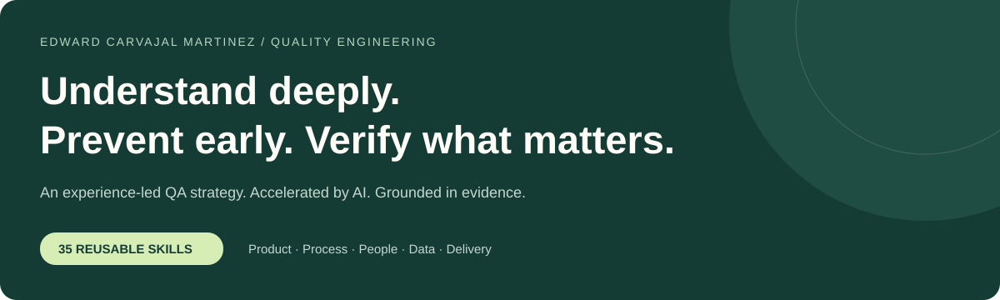
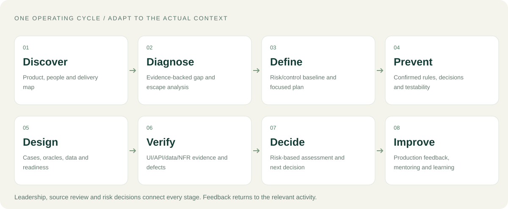
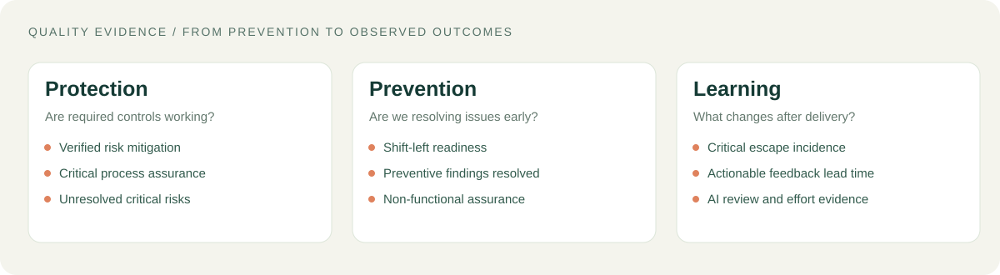

# Quality Engineering · Strategy & AI

### Edward Carvajal Martinez

**Understand deeply. Prevent early. Verify what matters.**



My QA approach brings together 25+ years of software quality work across complex business processes, integrations and data. I combine product understanding, risk-based prevention, hands-on verification, leadership and AI-assisted work into one adaptable operating method.

**[Explore the visual strategy](index.html)** · **[Read the strategy](QA_STRATEGY.md)** · **[See all 35 skills](docs/skills.md)** · **[Use with your LLM](docs/llm-clients.md)**

Open `index.html` locally for the interactive view. GitHub's file viewer displays its source; the visual below and the Markdown diagrams render directly in the repository. The interactive view also works with ordinary static hosting when configured separately.

## Execute and show the work

**[Automation setup](docs/automation.md)** · **[Test-type coverage and skills](docs/test-types.md)** · **[Download cases for Azure Test Plans](test-case-export.html)**

```bash
npm ci
npx playwright install chromium
npm run test:automation
```

Postman owns the API suite. Playwright verifies UI and baseline accessibility/configuration. Workspace MCP configurations connect compatible clients after trust/start. The self-contained case exporter selects cases and produces Azure Test Plans CSV. The included target verifies the framework locally; real product coverage requires confirmed contracts, rules and environment. See [recorded verification](data/framework-validation.json).

## The operating cycle



| Understand & diagnose | Prevent & verify | Decide & improve |
|---|---|---|
| Learn the product, people and actual delivery flow. Trace how failures are introduced and escape. | Clarify rules early. Design coverage around risk. Validate UI, APIs, integrations, data and agreed quality attributes. | Present current protection and residual risk. Give a supported release recommendation. Learn from production and develop team capability. |

## Value from the first day

**A clear picture and a concrete next action.** Follow one real workflow, examine one current change and available escape evidence, review coverage with the team and produce a source-linked map of facts, questions, risks and priorities. AI accelerates the analysis; accountable review establishes what is true.

| Need | My approach | Inspectable output |
|---|---|---|
| Defects reach production | Reconstruct introduction causes, detection gaps and release decisions | Escape analysis and focused control improvement |
| Requirements are unclear | Challenge rules, exceptions, states and dependencies before implementation | Confirmed decisions and risk-based coverage |
| Data or integrations are unreliable | Trace source → transformation → persistence → consuming behavior | Contract/failure-mode evidence and SQL reconciliation |
| Testing arrives late | Inspect queues, testability, data readiness and delivery batch size | Visible blockers and an earlier feedback intervention |
| Automation is brittle | Select stable protections at the lowest effective layer and verify enforcement | Maintained assertions, actual runs and clear ownership |
| The team needs direction | Set standards, prioritize capacity, pair on real work and grow independence | Shared agreements, reviewed work and mentoring outcomes |

## Experience behind the method

Aviation journeys, banking and payments, legacy/data modernization, enterprise operations and QA leadership inform the same recurring decisions: understand the process, expose the important failure, verify the protection and make the next action clear. [Experience translated into practice](docs/experience.md).

## How AI fits

**Sources → selected skill → AI proposal → accountable review → actual verification → quality decision.**

The same method can be read by any LLM. Claude Code, Gemini CLI and Copilot have client-specific discovery support; other clients can receive the relevant Markdown procedures directly. Tool access belongs to the host, not to the model or a skill file.

## Measure the quality that matters



Lead with verified risk mitigation, unresolved critical risks, critical process assurance, shift-left readiness, preventive findings resolved and non-functional assurance. Use source/data/contract, automation, escape and feedback measures to investigate the underlying problem. Show counts, denominators, source/build and missing evidence. Operational case counts support the conclusions.

## Repository map

| Location | Purpose |
|---|---|
| [index.html](index.html) | Interactive strategy, methods, skill explorer, problem navigator, metrics and LLM usage |
| [QA_STRATEGY.md](QA_STRATEGY.md) | Complete adaptable QA strategy |
| [START_HERE.md](START_HERE.md) | Begin or resume an actual engagement |
| [docs/skills.md](docs/skills.md) | What every skill does, its inputs, outputs and appropriate use |
| [docs/methods.md](docs/methods.md) | Techniques and the reasoning for choosing them |
| [docs/problem-solving.md](docs/problem-solving.md) | Evidence-led responses to common delivery and quality problems |
| [docs/metrics.md](docs/metrics.md) | Primary KPI definitions and verification rules |
| [docs/quality-diagnostics.md](docs/quality-diagnostics.md) | Supporting quality, integration, data and AI measures |
| [docs/llm-clients.md](docs/llm-clients.md) | Claude Code, Gemini CLI, Copilot and other LLMs |
| [docs/procedures/](docs/procedures/) | 35 authoritative procedures |
| [docs/project-templates.md](docs/project-templates.md) | Working records for discovery through release and improvement |
| [reports/quality-report-template.html](reports/quality-report-template.html) | Evidence-driven project report template |
| [scripts/](scripts/) · [tests/](tests/) | Deterministic metric calculations and checks |

The visual strategy describes how I work. Project outcome charts are populated only from an actual reviewed evidence ledger. Business rules, acceptance targets and release authority come from each engagement.

## Reproduce the portfolio checks

```bash
python scripts/build_visuals.py
python scripts/validate_repository.py
python -m unittest discover -s tests -v
node tests/test_primary_metrics.cjs
python scripts/calculate_metrics.py
```

Python's standard library and Node.js run these checks; the visual strategy opens without a server or package installation. The checks validate this repository's structure and measurement tooling, not an external product. See [the evidence data contract](docs/data-contract.md) before populating a project report.
