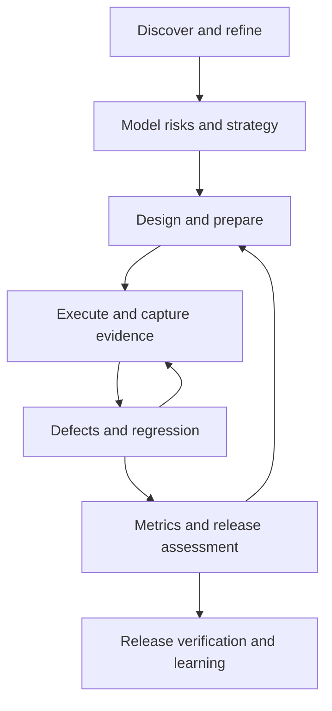

# QA Testing Lifecycle Skills

**Revision 1.1 — Playwright MCP and discoverable project skills.** Start with [START_HERE.md](START_HERE.md) for local client setup and the live CTO exercise. The package now includes 35 numbered procedures and 35 lightweight `qa-*` skill entry points.

**A Markdown instruction library for a Senior QA, QA Lead and automation strategist.** Designed around Edward’s business-first functional QA approach and the requested fintech, payments, remittances, web, UI, desktop, API, SQL/integration and leadership scope. The profiles are working perspectives, not invented certifications, employer achievements or measured results.

Use these skills with an LLM to coordinate the testing lifecycle. They provide procedures and reviewable artifacts. They do not install tools, authenticate by themselves, create a running system or guarantee execution.

## Start in three steps

1. Open [MASTER_PROMPT.md](MASTER_PROMPT.md), [90-OPERATING-CONTRACT.md](90-OPERATING-CONTRACT.md) and [00-orchestrate-testing-lifecycle.md](00-orchestrate-testing-lifecycle.md).
2. Supply your scope and sources. Load the relevant numbered files as the orchestrator reaches their stages. Do not load all files blindly if the model has a small context window.
3. Start with **OFFLINE_DEMO** and [99-CTO-FIVE-MINUTE-WALKTHROUGH.md](99-CTO-FIVE-MINUTE-WALKTHROUGH.md), **SOURCE_ANALYSIS** for real supplied stories/exports without connecting, or **CONNECTED_READ** for your real Azure backlog. Actual test execution and remote updates need their corresponding authorized modes and real tools.

The files are ordinary portable Markdown. This revision includes project-local `.claude/skills/qa-*/SKILL.md` entry points for Claude Code and compatible Cursor discovery. Keep the complete bundle together and open its folder as the workspace; the entry points reference the numbered root procedures. See [SKILLS_INSTALLATION.md](SKILLS_INSTALLATION.md). Generic LLMs can still load the numbered procedures directly. A discovered skill does not itself provide MCP tools; follow [PLAYWRIGHT_MCP_SETUP.md](PLAYWRIGHT_MCP_SETUP.md).

## Lifecycle map

Leadership and AI/evidence review apply throughout. Publication is a separate authorized action. Some tracks run in parallel, and irrelevant tracks are explicitly marked Not applicable.

Business UAT is coordinated in planning (09) and evaluated with its real business-owner sign-off in release readiness (28); QA does not substitute its own recommendation for that acceptance.

## Numbered skill index

| Order | Skill | Use |
|---|---|---|
| 00 | [Orchestrate the testing lifecycle](00-orchestrate-testing-lifecycle.md) | Coordinate a complete or partial QA engagement, resume a checkpoint, or explain the lifecycle to leadership. |
| 01 | [Connect to Azure DevOps securely](01-connect-azure-devops-securely.md) | Access Azure DevOps as the user, verify the authenticated account, or diagnose a failed connection. |
| 02 | [Read the dashboard and backlog](02-read-dashboard-and-backlog.md) | Collect user stories or PBIs from an Azure dashboard, saved query, sprint board or supplied export. |
| 03 | [Map story dependencies and execution order](03-map-story-dependencies.md) | Determine which stories depend on others, identify blocking chains and sequence testing. |
| 04 | [Analyze acceptance criteria and refine stories](04-analyze-acceptance-criteria-and-refine.md) | Review incomplete, complex or ambiguous user stories and prepare actionable refinement questions. |
| 05 | [Model business processes and state transitions](05-model-business-processes-and-states.md) | Translate complex journeys into testable state, decision and integration models. |
| 06 | [Assess fintech, payments and remittance behavior](06-assess-fintech-payments-and-remittances.md) | Assess financial integrity and business risk in payment, refund, settlement, FX or remittance workflows. |
| 07 | [Prioritize product and test risks](07-prioritize-product-and-test-risks.md) | Choose testing effort based on business exposure, technical change and evidence gaps. |
| 08 | [Recommend an adaptive test strategy](08-recommend-adaptive-test-strategy.md) | Explain the QA approach as a senior leader and adapt functional, manual, automation and nonfunctional coverage. |
| 09 | [Plan and estimate testing](09-plan-and-estimate-testing.md) | Estimate QA work, coordinate people and dependencies, and create a realistic execution plan. |
| 10 | [Design functional test cases](10-design-functional-test-cases.md) | Turn confirmed requirements and risks into clear manual or automation-ready test cases. |
| 11 | [Review coverage and traceability](11-review-coverage-and-traceability.md) | Check whether stories, risks, cases, results and defects form an auditable evidence chain. |
| 12 | [Prepare and control test data](12-prepare-synthetic-test-data.md) | Define safe, reproducible data for functional, automation, financial or nonfunctional testing. |
| 13 | [Verify test environment readiness](13-verify-test-environment-readiness.md) | Determine whether a target build and its dependencies are ready for trustworthy execution. |
| 14 | [Select and run smoke tests](14-select-and-run-smoke-tests.md) | Quickly assess build testability before deeper regression or specialized testing. |
| 15 | [Decide what to automate and what to keep manual](15-decide-what-to-automate.md) | Prioritize automation investment and explain exclusions or deferrals. |
| 16 | [Design and maintain test automation](16-design-and-maintain-test-automation.md) | Specify or improve an automation suite after candidates and runtime are selected. |
| 17 | [Execute API and integration tests](17-execute-api-and-integration-tests.md) | Validate APIs, service contracts, asynchronous integrations or provider sandboxes. |
| 18 | [Validate SQL, data integrity and migrations](18-validate-sql-data-and-migrations.md) | Check persisted effects, reconciliation, migration correctness or data quality. |
| 19 | [Execute manual and exploratory web/desktop tests](19-execute-manual-exploratory-web-and-desktop-tests.md) | Run supervised manual cases or exploratory sessions across UI, web and desktop surfaces. |
| 20 | [Execute web tests with Playwright](20-execute-web-tests-with-playwright.md) | Bind and run approved web cases with an available Playwright environment. |
| 21 | [Assess and execute nonfunctional tests](21-assess-and-execute-nonfunctional-tests.md) | Plan or execute proportionate performance, resilience, security, accessibility and compatibility checks. |
| 22 | [Report, triage and resolve defect disagreements](22-report-triage-and-resolve-defects.md) | Document a reproducible failure, prioritize it and handle a developer who disputes the finding. |
| 23 | [Verify fixes and reopen defects](23-verify-fixes-and-reopen-defects.md) | Retest a claimed fix, validate related behavior and decide whether a defect can close. |
| 24 | [Select and execute impact-based regression](24-select-and-execute-impact-based-regression.md) | Choose regression scope after a fix, story change, integration update or release candidate. |
| 25 | [Coordinate CI and continuous validation](25-coordinate-ci-and-continuous-validation.md) | Design or run automated feedback in an existing authorized delivery pipeline. |
| 26 | [Calculate meaningful quality metrics](26-calculate-quality-metrics.md) | Calculate transparent QA metrics for a defined scope, build and reporting period. |
| 27 | [Produce clear visual quality reports](27-produce-clear-visual-quality-reports.md) | Explain what was tested, what was observed and what decision follows for a CTO or delivery team. |
| 28 | [Evaluate release readiness and risk](28-evaluate-release-readiness-and-risk.md) | Recommend Go, conditional approval or No-Go using evidence and explicit decision authority. |
| 29 | [Verify release and coordinate incidents](29-verify-release-and-coordinate-incidents.md) | Plan safe postrelease verification and support an authorized incident response. |
| 30 | [Close testing and improve the process](30-close-testing-and-improve-process.md) | Close an iteration/release QA effort and turn evidence into practical improvements. |
| 31 | [Lead people, mentor and communicate](31-lead-people-mentor-and-communicate.md) | Coordinate QA contributors, coach a junior tester, resolve conflicts or explain quality decisions to stakeholders. |
| 32 | [Review AI output and protect evidence](32-review-ai-output-and-protect-evidence.md) | Check LLM-generated QA artifacts, source grounding, tool truthfulness and sensitive-data handling. |
| 33 | [Publish approved results to Azure DevOps](33-publish-approved-results-to-azure-devops.md) | Create or update authorized Azure stories, test artifacts, bugs, links or result summaries. |
| 34 | [Connect Playwright MCP and bind QA skills](34-connect-playwright-mcp.md) | Set up and verify the actual browser connection before skill 20. |

## Supporting files

- [START_HERE.md](START_HERE.md): shortest path from extraction to an English presentation.
- [SKILLS_INSTALLATION.md](SKILLS_INSTALLATION.md): discoverable project skill layout and GitHub publishing.
- [PLAYWRIGHT_MCP_SETUP.md](PLAYWRIGHT_MCP_SETUP.md): real Claude Code/Cursor connection setup and optional official CLI skill.
- [CTO_LIVE_DEMO.md](CTO_LIVE_DEMO.md): visible browser exercise, scoped authorization prompt and evidence-based report.
- [MASTER_PROMPT.md](MASTER_PROMPT.md): one reusable full-cycle instruction, with resume behavior.
- [90-OPERATING-CONTRACT.md](90-OPERATING-CONTRACT.md): modes, provenance, status rules, scope and handoffs.
- [91-REUSABLE-TEMPLATES.md](91-REUSABLE-TEMPLATES.md): copyable QA artifacts.
- [95-VALIDATION-EXERCISES.md](95-VALIDATION-EXERCISES.md): scenarios to test the LLM’s behavior.
- [98-SOURCES.md](98-SOURCES.md): official Azure/Playwright references and adaptation limits.
- [99-CTO-FIVE-MINUTE-WALKTHROUGH.md](99-CTO-FIVE-MINUTE-WALKTHROUGH.md): short, visual, fully fictitious demonstration.

## Usage examples

“Use 00 and the shared contract in CONNECTED_READ mode. Read only my selected Azure query, map confirmed dependencies, review criteria and design risk-based coverage. Do not execute tests or publish changes.”

“Use the approved nonproduction scope in this session. Resume the checkpoint, verify readiness, execute the approved Playwright/API cases with available tools, and report actual evidence. Keep unavailable tracks blocked.”

“Review these artifacts as a QA lead. Prepare a release recommendation and a one-minute CTO explanation. Do not deploy or change any approval status.”

## Credential and evidence rules

Use an existing authorized session or legitimate interactive sign-in. Enter your username/password only in the identity provider’s secure UI; never put passwords, tokens or cookies in prompts, skills or GitHub. Azure Services and Azure Server authentication differ. Browser access alone does not provide a connector or API capability.

GitHub renders Markdown tables and supported Mermaid diagrams. These files include exact-value tables as a fallback. Publish only sanitized artifacts; private project URLs, customer data and internal evidence may require redaction before a public repository upload.

## What has and has not been verified

The package is an authored instruction library with consistency checks and a simulated walkthrough. It does not claim a real Azure connection, live Playwright run, actual defect creation or human release approval. Adapt field mappings, contractual expectations and runtime capabilities to the real project before connected use.
