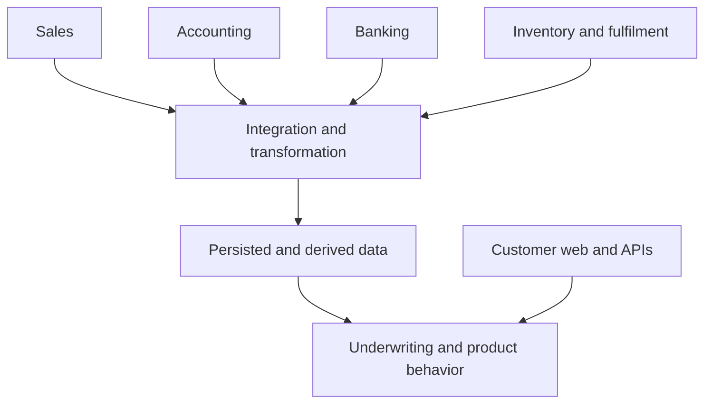

# CapRelease — QA ownership and delivery strategy

**Edward Carvajal Martinez · Senior QA Engineer / QA Lead**

**Status: proposed engagement strategy, based on the vacancy supplied by the candidate.** No CapRelease system, codebase, database, pipeline, incident or team practice has been independently assessed. The vacancy is source CR-JD-01. The candidate's report of a junior tester and escaped production bugs is CR-CONTEXT-01; confirm the current situation during discovery. This profile applies the [general strategy](../../QA_STRATEGY.md); it does not replace it with an industry tutorial.

## Context supplied by the vacancy

CapRelease describes growth capital for UK eCommerce retailers, advertised from £20k to £1m, combining inventory and revenue finance in a blended facility with one fixed fee. It describes four operational signal groups and 24–72-hour decisions. These are vacancy statements, not confirmed executable rules: establish actual eligibility, amount boundaries, fee/rounding policy, signal requirements and timing definitions with the owners before testing them.

## Executive position

I would own the QA operating approach and remain hands-on across the customer web experience, REST APIs, integration boundaries and Azure SQL data. My first responsibility would be to understand how CapRelease actually delivers and where important failures escape. I would then agree a focused improvement, coach the existing tester through it, verify the controls and report the remaining risks in business language.

The initial quality question is: **Can the team rely on the relevant source data, its transformation and the resulting customer/underwriting behavior, and can we explain the evidence before release?** This does not assume QA decides lending policy. Product, underwriting and the appropriate decision owners define correct rules and acceptable exceptions; QA challenges ambiguity and verifies implementation against them.

## 1. What the role requires me to own

| Responsibility | My operating commitment | Evidence the CTO can inspect |
|---|---|---|
| Quality direction | Define the contextual strategy, risk priorities, required evidence and escalation route with the team | Reviewed strategy, control baseline and decision record |
| Hands-on delivery | Personally investigate and validate important UI, API, integration and data behavior | Source-linked cases, request/response evidence, SQL reconciliation and reproducible defects |
| Early prevention | Challenge unclear requirements before affected implementation; resolve with Product/Engineering | Questions, confirmed decisions, chronology and preventive findings |
| Automation and release gates | Select maintainable checks, implement within agreed scope and prove enforcement in the real pipeline | Reviewed changes, actual pipeline runs, artifacts and gate verification |
| Integration/data integrity | Verify failure/recovery and actual persisted/consumed effects, not just response codes | Contract/failure-mode coverage and source-to-decision lineage |
| Leadership | Set standards, prioritize capacity, pair on difficult work and develop independent judgment | Responsibility/mentoring records and reviewed work samples |
| Communication | Raise material concerns proactively in writing and meetings, with a recommendation and next action | Decision-ready English updates and an auditable risk/exception trail |

## 2. Deliver value from day one

The first day is a proposed reviewable outcome, not a promise to finish discovery or prevent a measured number of bugs. Protect already scheduled essential validation. With access and contributor availability, deliver the following; otherwise provide explicitly bounded drafts and exact prerequisites.

| Day-one activity | AI contribution | My review / hands-on contribution | Reviewable output |
|---|---|---|---|
| Align with the CTO, Product, developers and tester | Organize supplied notes into goals, decisions, constraints and open questions | Listen, distinguish symptoms from causes, identify immediate commitments and urgent risk | One-page context and decision map, reviewed or Pending review |
| Follow one real workflow | Draft a source-linked actor/state/dependency map | Check it against a walkthrough and contributor explanations | Current process map with unknowns, not an invented architecture |
| Review one current change and one available production escape | Extract ambiguities, candidate failure scenarios and chronology | Confirm business expectations, reproduce/investigate if access permits; separate defect cause from escape cause | Focused risk/coverage review and evidence-backed questions |
| Pair with the current tester | Suggest negative, boundary and dependency scenarios for review | Ask the tester to explain reasoning; compare proposed coverage and prioritize | Reviewed work sample and a coaching goal |
| Close the day proactively | Assemble an English executive summary from the reviewed ledger | Confirm every statement and identify who must decide next | Current facts, provisional risks, blockers, proposed pilot and next action |

**Not claimed on day one:** completed integration assurance, deployed gates, fewer production incidents, measured time improvement or verified risk mitigation without the corresponding evidence. Unknown KPIs are Not measured; they are not zero.

## 3. First improvement cycles

First working days: learn the product and team; inspect actual throughput, WIP, waits, test time and release decisions. Use the existing delivery approach; confirm Scrum practices reported by the candidate rather than impose a new ceremony. Understand how priorities shift in the small senior team.

First diagnostic review: examine a bounded sample of escaped defects, important changes and successful delivery. Record the sample selection, period, build/configuration and missing evidence. Identify the introduction mechanism separately from the detection/decision gap. Do not attribute the problem to the junior tester without evidence.

First pilot: choose one confirmed, consequential gap with Product/Engineering and the tester. Define one process/change, expected protection, implementation owner, verification and review point. Examples are earlier clarification, source-to-target checks, retry recovery or a reliable required CI check, selected from actual findings. Pair on the first difficult verification, then have the tester execute and present subsequent evidence.

Following cycles: retain or adapt the pilot based on evidence, extend relevant regression, implement justified automation and review recurrence. A proposed 30/60/90-day direction is: establish a trustworthy baseline and one proven improvement; broaden useful controls and ownership; evaluate production outcomes and maintainability. These are review horizons, not guaranteed milestones or numerical promises.

## 4. Architecture and business-risk lens

The vacancy describes Azure, C# ASP.NET Core APIs, Python services, Azure SQL, customer web front ends and third-party sources. Actual boundaries, environments, hosting, messaging and monitoring are not yet known. Do not assume particular Azure services, vendors, tables, endpoints or model architecture.

This is a logical assurance view inferred from CR-JD-01, not a verified deployment diagram. The four signal groups must each appear in discovery and the test model. Confirm which sources, timestamps and quality policies are required for each decision; the vacancy does not specify that every decision must block whenever any signal is absent.

| Proposed risk to investigate | Business relevance | Verification approach, conditional on actual rules |
|---|---|---|
| Stale or incomplete source information is treated as current/complete | Assessment may use a misleading operating picture | Source/ingestion/as-of timestamps, completeness policy, UI/API flags and decision eligibility |
| Mapping, units, currency, periods or signs change incorrectly | Derived values may differ from the source | Independent expected values, field-level checks and aggregate plus row-level reconciliation |
| Duplicate/reordered/replayed ingestion affects downstream values | Updates may be counted twice or states overwritten | Contract-based replay, ordering and repeat-processing checks with persisted assertions |
| A dependency fails, throttles or returns partial data | The process may stall or show false success | Bounded retry/backoff, recovery, partial-state behavior and observability against confirmed policy |
| Merchant/organization data or actions cross an authorization boundary | Confidential data or protected actions may be exposed | Actual identity/role/data-scope tests across UI, APIs and data queries |
| A rule/version or exception cannot be traced | An outcome may be difficult to explain or reproduce | Input snapshots/references, lineage, rule versions and approved decision/audit requirements |
| A late change bypasses validated coverage | The release may lack applicable assurance | Build/commit/config binding, impact selection and required checks |

These are discovery hypotheses, not findings about CapRelease. The stated blended facility and fixed fee require Product-approved calculation, eligibility, rounding, boundary and exception rules before assertions are designed. QA may validate monetary business inputs without estimating company costs, savings or ROI.

The advertised 24–72-hour decisions motivate asking how elapsed time is defined, where waiting occurs and what information must be ready. Do not convert that statement into an API response-time threshold or a universal contractual SLA. Distinguish source acquisition, technical processing, manual review and the business decision.

## 5. Hands-on verification by layer

| Layer | What I will verify | AI assistance and review boundary |
|---|---|---|
| Customer web | Critical journeys, validation, error/partial states, permissions, accessibility and supported devices; source-backed UI/API consistency | Draft Playwright/TypeScript candidates from real UI; inspect selectors/assertions and execute on the actual build before claiming automation |
| ASP.NET Core REST APIs | Contract/version, authorization, validation, state changes, errors and persisted effects; actual C# serialization/nullability/date/decimal behavior at boundaries | Draft assertions from OpenAPI and confirmed rules; review discrepancies with developers; do not invent routes/status codes |
| Python services | Transformation and calculation boundaries, serialization, numeric/date handling, missing/invalid values and cross-language contracts where applicable | Propose parametrized checks and debugging hypotheses; review against code/contracts and independently calculated expectations |
| SQL Server / Azure SQL | Write and inspect my own T-SQL using the actual schema: joins/cardinality, nulls, keys, relationships, stored-procedure outputs/side effects, transaction behavior, source-target mapping and discrepancies | AI may draft queries; I verify grain, join fan-out, filtering, precision and null semantics before use. Execution plans/index behavior support diagnosis; do not create indexes or alter procedures by implication |
| Third-party integrations | Contracts, pagination/completeness, mapping, expired access, timeouts, provider errors, retries, rate limits, duplicate/reordered records, schema changes and recovery where applicable | Expand a provider-specific failure matrix from real contracts; distinguish controlled stubs, provider sandbox and actual integration observations |
| End-to-end data path | Trace a source record/change through ingestion, transformation, persisted/derived state and its actual consumer/UI/decision output | Link correlation IDs, snapshots and revisions; matching counts or HTTP 200 alone cannot prove correctness |

Build test data through reviewed fixtures/scripts in an authorized isolated environment. Use SQL writes only within approved scope; test transactions and cleanup depend on actual schema behavior. Do not use production customer data as a convenience. Read-only investigation and source analysis can proceed while execution access is pending.

## 6. Automation and Azure DevOps enforcement

Choose the lowest effective layer with a clear oracle: developer/component checks for isolated rules, contract/API/integration/data checks for service behavior, selected UI journeys for cross-layer outcomes, and manual exploration for discovery and usability. Retain manual checks where automation is not sustainable. No universal automation percentage is promised.

Inspect existing .NET/Python test frameworks, Playwright/Cypress/Selenium use, repository conventions, pipeline YAML/classic definitions and environment topology before changing them. Reuse working suites. Postman or an equivalent API client supports hands-on analysis; choose maintainable automated execution based on actual project needs.

Proposed stages: change-focused fast feedback; safe integration/contract/data checks; selected UI/smoke/regression against the intended build; bounded scheduled non-functional checks as appropriate; and a release assessment that links all required evidence. Confirm triggers, runner, dependencies, secrets, isolation, output formats and owners.

A published test result is not automatically a gate. Verify assertion/test-runner exit behavior, result publication and branch/stage enforcement. Inspect missing result files, skipped essential tests, retries, continue-on-error, quarantine and pipeline cancellation. Prove in a safe pipeline test that a required failed/missing check actually prevents progression. Preserve artifacts on failed runs without allowing the publish step to hide failure. No deployment is implied by test execution authorization.

For PublishTestResults@2, Microsoft documents separate options for failing on failed tests, publication failure and missing files. Inspect and configure them deliberately for the selected pipeline; their documented defaults do not create an enforcement policy. The project still needs actual run/selection completeness checks and enforced branch/stage dependencies.

**Evidence of delivery:** implemented reviewed tests, valid assertions, reproducible fixtures, linked actual runs, visible first-attempt/retry outcomes, verified gate behavior and a named maintenance owner. A generated script or green badge alone is insufficient.

## 7. Non-functional assurance

| Area | Initial investigation and verification | Essential boundary |
|---|---|---|
| Performance | Identify critical technical operations, realistic mix/volume, processing latency, resource context and agreed p95/p99/error targets; choose k6/JMeter or existing tooling if appropriate | Business decision turnaround is not an API SLA; no invented load target or claimed tool expertise |
| Resilience | Dependency outages, bounded retries, rate-limit recovery, replay/backfill, partial processing, restart/recovery and data consistency within authorized scope | Confirm permitted experiments, stop conditions and recovery objectives before execution |
| Accessibility | Confirm agreed WCAG version/level and supported journeys; combine automated checks with keyboard, focus, labels/errors, zoom and relevant assistive-technology review | Automated tools alone cannot establish conformance |
| Security basics | Actual authentication/authorization, data isolation, object access, validation, sensitive-data/log exposure, secure secret handling and relevant dependencies/configuration | Coordinate specialist review; no penetration-test, certification or legal-compliance claim from a small checklist |
| Regulatory/operational expectations | Ask the responsible owner which obligations, retention, audit and service controls apply to CapRelease's actual permission/activity scope | CR-JD-01's FCA-registered description does not establish that every FCA rule applies |

## 8. Release authority and proactive communication

Agree what must be true before production: source-backed behavior, essential current control evidence, relevant contracts/integration/data checks, applicable NFRs, reviewed open defects, required business acceptance and operational readiness. Record exact scope/build and incomplete areas.

Raise a material risk promptly without waiting to be asked. Use: **affected process → observed failure or missing evidence → business consequence → QA recommendation → required action/owner → decision deadline**. Pair with developers on reproduction and remediation; distinguish disagreements about expectations from implementation defects.

Example wording structure, to fill only with actual evidence: “The release candidate does not yet have verified evidence for [essential control]. That leaves [specific process consequence] unresolved. My recommendation is [No-Go/Pending assessment under the agreed policy]. We need [action/evidence] from [actual owner] before [review point].”

QA owns the recommendation and can challenge senior stakeholders confidently. The designated release authority records the actual decision and exceptions. Missing essential evidence cannot be averaged away by a high pass rate. A consciously accepted risk remains residual.

For distributed work, agree UK/Colombia overlap and escalation coverage with the actual team. Keep written decisions, reproduction context, blockers and checkpoints actionable across time zones. Confirm Medellín/location expectations and home-working reliability separately; they are candidate logistics, not quality KPIs.

## 9. Lead the QA function as it grows

Create a small set of shared standards: source-grounded criteria, risk-based prioritization, reproducible cases/defects, controlled data, current evidence and explicit release decisions. Keep the useful practices already in place. Prioritize the team's capacity and make deferred risks visible.

Pair with the current tester on one real story: they explain the process and risk reasoning; I review gaps; we verify the hardest scenario; they lead the next checks and explain their evidence. Assess growing independence with reviewed work samples, not case volume. Distribute relevant testing responsibility across developers and domain owners, define reviewers/backups and review standards as the function expands.

## 10. What the CTO sees

Use [CTO_BRIEF.md](CTO_BRIEF.md) for the opening and [KPI_DICTIONARY.md](KPI_DICTIONARY.md) for exact definitions. The [role matrix](ROLE_TRACEABILITY.md) maps every vacancy requirement to planned work, relevant skills and proof. The [AI evidence plan](AI_EVIDENCE_AND_ACHIEVEMENTS.md) distinguishes delivered portfolio assets, user-reported experience and proposed CapRelease results.

The report leads with the six existing process-risk KPIs. Expand role-specific diagnostics only when needed: integration failure-mode protection, decision-data traceability, critical data/contract assurance, enforced automation, critical production escapes and feedback timing. AI acceptance and effort comparisons are supporting evidence, not a substitute for product quality.

No costs, savings, ROI, money-at-risk estimates or fabricated achievement percentages are required. Baseline unknowns remain explicit. The first review demonstrates understanding and decision quality; later reviews demonstrate implemented protections and observed outcomes.

## Sources and limits

- CR-JD-01: complete vacancy text supplied in the current request. Business and platform statements are attributed to that text; no internal implementation has been inspected.
- CR-CONTEXT-01: candidate-supplied description of existing QA capacity and production escapes; confirm with CapRelease.
- Microsoft PublishTestResults@2: https://learn.microsoft.com/en-us/azure/devops/pipelines/tasks/reference/publish-test-results-v2?view=azure-pipelines — task options; not proof of the company's configuration.
- W3C evaluation guidance: https://www.w3.org/WAI/test-evaluate/ — automated and human evaluation are complementary; this profile asserts no conformance.
- FCA operational resilience: https://www.fca.org.uk/firms/operational-resilience — applicability is scoped by firm/activity; confirm actual obligations with the responsible owner.
